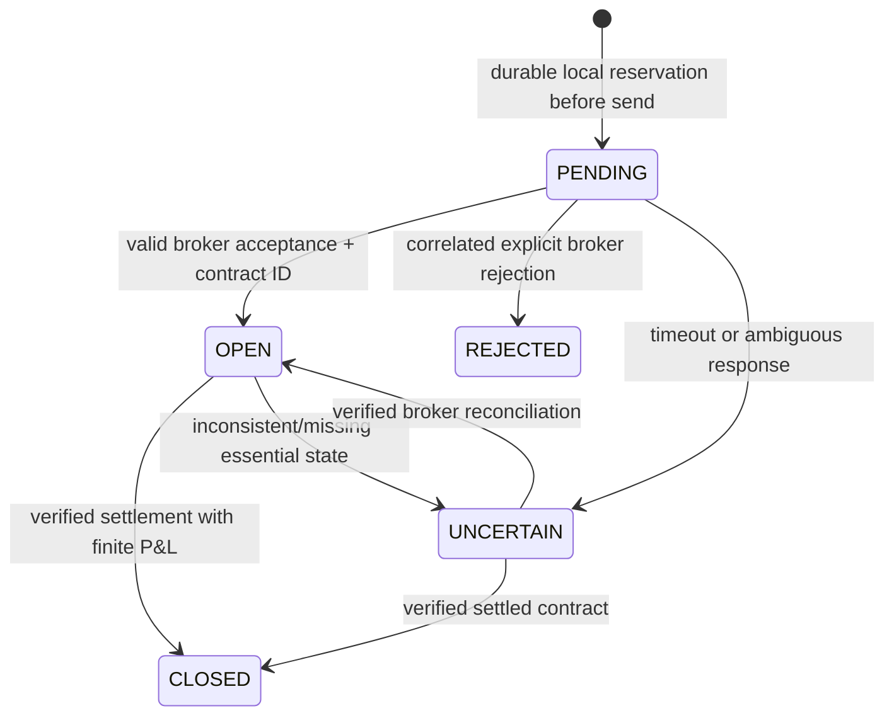

# Database and API contracts

These are local single-user APIs. They require the application's exact localhost Host header and reject cross-origin write requests. JSON mutation routes require `Content-Type: application/json`; body limits apply. They are not public endpoints, do not implement remote user authentication, and must not be reverse-proxied onto the Internet.

Error responses have an `error` string and an appropriate non-2xx status. Invalid/missing state is never permission to trade. Tokens and OTP URLs must not appear in journal/export responses.

## Safety, health and audit APIs

| Method and route | Request / response |
|---|---|
| `GET /api/risk/status` | `{account_id, mode, connected, risk, limits, state, halted, halt_reason}`. While disconnected, global stop state remains available; account-specific values may be absent. |
| `POST /api/risk/kill` | Optional `{reason}`. Persists global emergency halt, stops new automation and clears local quotes. Returns risk status. Does not close broker contracts. |
| `POST /api/risk/resume` | `{confirmation: "RESUME DEMO TRADING"}`. Explicitly resumes emergency interlocks where permitted, without resetting losses/equity/audit or bypassing unresolved orders. |
| `POST /api/risk/reset` | Compatibility alias for resume only; does **not** reset risk baselines or erase history. Prefer `/resume`. |
| `POST /api/risk/config` | Partial object containing documented risk fields, for example `{risk_per_trade_pct: 0.5, daily_loss_pct: 2}`. Account must be connected; stop automation and resolve outstanding orders first. Values remain within enforced bounds. |
| `POST /api/risk/calendar` | `{events, updated_at, valid_until, source}` with trustworthy licensed coverage and UTC epoch timestamps. Stop automation before updating. |
| `GET /api/audit` | `{events, risk_events, integrity, orders, risk_integrity, scope}`. Local order/risk evidence, chain verification and materialized-state checks; not independently notarized broker proof. |
| `GET /api/capabilities` | Version, deployment boundary, per-mode availability, supported product model and explicit limitations. |
| `GET /api/system/health` | Local process version/uptime, broker state, worker liveness, risk status, live-execution lock and audit integrity. Local `ok` does not certify broker permissions or profitable strategies. |

Risk configuration fields and ranges are listed in [OPERATIONS.md](OPERATIONS.md). Full risk state includes persisted config, killed/reason, day/week/baseline/peak/last equity, latest decision, calendar freshness and reservation counts. Audit export contains metadata and outcomes, never credentials.

Calendar event schema:

```text
{
  time: UTC_epoch_seconds,
  currencies: ["USD"] or ["*"],
  impact: "high",
  before_minutes: 30,
  after_minutes: 30,
  name: human_readable_release_name
}
```

This is a schema example, not an actual current event or valid calendar. `updated_at`, `valid_until` and `source` must reflect authentic coverage. Missing or stale coverage blocks affected automation.

## Research and strategy APIs

| Method and route | Contract |
|---|---|
| `GET /api/strategy/catalog` | Seven strategy definitions and allowed profile/timeframe pairs. |
| `GET /api/strategy/status` | Active action/account/rules, latest note/error, recorded signal events, separate paper balance/positions and regime/explanation where present. |
| `POST /api/strategy/backtest` | `{source, strategy, profile, timeframe, payout, stake, expiry_bars, target_win_rate, ...}`. Sources: `synthetic`, `csv` (validated OHLC array in `candles`), or `deriv` (connected broker symbol). Optional costs: `commission_per_trade`, `spread_bps`, `slippage_bps`; parameters/regime options supported where documented by source. Returns net metrics, train/holdout/folds, trades, provenance, costs, regime and warnings. |
| `POST /api/strategy/scan-all` | Same history/model controls, evaluated for all seven strategies. Ranks using training evidence only and tests one training candidate on the untouched holdout. No fallback winner chosen from holdout. |
| `POST /api/strategy/start` | Explicit `{strategy, profile, timeframe, symbol, action, stake, expiry_minutes}`. `action`: `monitor`, `paper_trade`, `demo_trade`. Demo is short-expiry and account/capability/risk gated. |
| `POST /api/strategy/start-best` | Explicit action/stake/expiry for the server-retained validated broker-data candidate. Client cannot forge a selected winner. Synthetic/CSV findings cannot authorize broker deployment. |
| `POST /api/strategy/stop` | Stops this supervisor; existing broker contracts remain distinct. |

The fixed-expiry research model defaults to **1,000 units independently allocated to training and to the final holdout**. The combined overall equity/return uses the sum of those allocations (**2,000 units** by default), not a fictitious reset on one bankroll. Each training-only walk-forward validation fold also has independent starting capital; purged boundary-crossing trades cannot fund or starve a later segment. See `capital_model` in each report. Cost defaults are commission 0, spread 1 basis point and slippage 0.5 basis point. These are configurable assumptions, not observed Deriv costs. Spread/slippage alter the outcome-price threshold; explicit commission is recorded separately. Trade risk and payouts follow the disclosed fixed-stake Options model rather than CFD lots.

Reports include source label, instrument/timeframe, bar/time boundaries, dataset and segment/fold SHA-256 identities, rule version, exact configuration, capital model and split/fold assumptions. A checksum establishes identity/reproducibility, not source authenticity. `research_pass` is a simulation gate, never a live-trading permit.

## Broker APIs and order lifecycle

Existing routes remain under `/api/deriv/`: account discovery, connect/disconnect, status/health, markets, candles, available durations, snapshot/reconciliation, quote, buy and explicit demo automation. `/arm` cannot enable real-money purchases in this version.

A quote requires symbol, `UP`/`DOWN`, stake and integer minute expiry. It returns a one-use token and broker price/payout fields; this is not a fill. `/buy` consumes that exact token, repeats broker/risk checks, writes a durable reservation, then submits once.



An unknown purchase without a contract ID cannot be automatically resolved using guesses. It blocks new entries until a trustworthy statement investigation establishes its outcome. `REJECTED` must never be used as a convenient way to clear uncertainty.

## SQLite schemas and migrations

Databases default to the checkout or the private `MIKEIZU_DATA_DIR`. `CREATE TABLE IF NOT EXISTS`, checked additive columns/indexes, and `PRAGMA user_version` provide in-process migrations. There is no external migration service. Back up the consistent state set before upgrading. Initialization preserves existing rows; it does not turn pre-migration activity into verified historical audit evidence.

| Database | Main tables and keys | Recorded content |
|---|---|---|
| `tradelab.db` | `settings(key PK)`, `candles(asset,tick PK)`, `trades(id PK)` | Synthetic practice settings, generated/imported OHLC and separate synthetic trades. |
| `deriv_order_journal.db` | `orders(id PK, nonce UNIQUE)`, `order_audit(id PK)` | Account, mode, symbol/direction, stake/ask/expiry, contract ID, explicit order state/P&L, timestamps; allowlisted `context_json` containing strategy/version/timeframe/signal/regime/rationale/data hash; linked audit events and materialized-state checks. |
| `naked_signals.db` | `strategy_events(id PK)` with unique account/symbol/timeframe/strategy/confirmation timestamp, `strategy_event_history(id PK)` | Signal mode/side/action, explanation/detail, version, regime, data hash, supporting evidence; separate append history preserves initial SIGNAL and later outcomes rather than overwriting the only record. |
| `naked_paper.db` | `paper_positions(id PK)`, `paper_accounts(account_id PK)` | Pending/open/closed/cancelled virtual entries, stops/targets/risk, quantity, exit/gross/net/cost assumptions, signal identity, account high-water mark and halt. |
| `risk_control.db` | `risk_state(account_id,mode PK)`, `risk_reservations(nonce PK)`, `risk_audit(id PK)`, `risk_global(id=1)` | Config/baselines/peak/calendar/halt; atomic maximum-loss reservations; hash-linked decisions and global interlock. |

The order journal uses schema revision 3 with additive context/audit migration and recorded materialized-row snapshots; the risk database uses schema revision 1. Migration behavior is defined in `Journal.__init__` and `RiskEngine.__init__`. Legacy orders are retained, but their original pre-audit history cannot be recreated or certified. Restoring a whole older database can evade a purely local hash chain; external anchored checkpoints remain future work.

## Compatibility changes

- The old manual-live opt-in and arm phrase no longer enable purchases. Real accounts are read-only.
- A newly persistent emergency halt survives restart. Resume is explicit and does not reset hard loss/equity controls.
- Missing/stale calendar blocks affected automated broker entries; monitor mode remains available.
- Paper signals queue for a next completed bar's open and have costs/default 0.5% risk. Old confirmation-close, cost-free, 1% paper expectations are obsolete.
- The 65% research target is informational; net evidence and chronological validation determine research eligibility.
- Older saved report assumptions remain historical. Do not rewrite them to look like the current strategy/model version.
