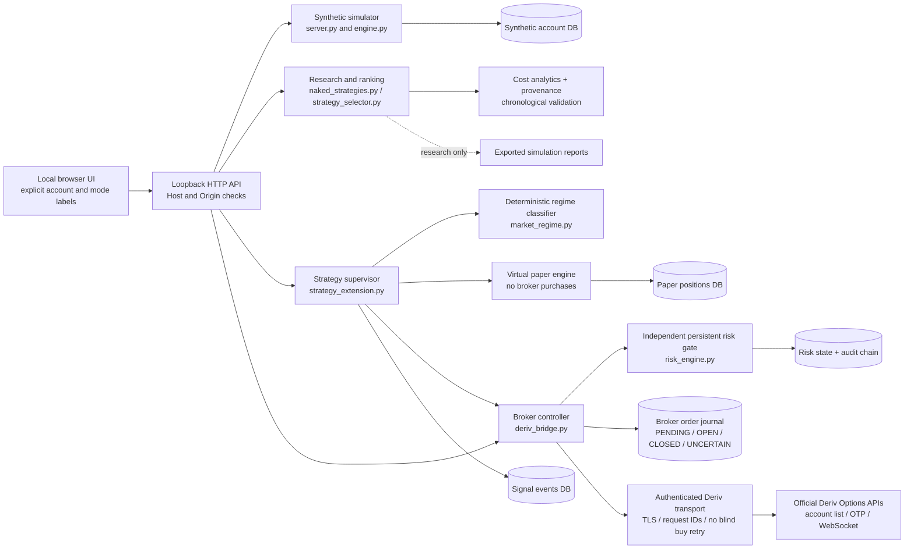

# Architecture and trust boundaries

The app is a single-user Python process serving a static browser UI on loopback. SQLite holds separate research/practice/broker/risk records. Credentials stay in browser/process memory during an authorized session; reconnecting requires fresh authentication. There is no external AI service or remote-hosting control plane.

## Execution boundary

A signal is an observation produced from completed candles, not an order. A quote is a time-limited proposal, not an accepted fill. Before a purchase, the broker controller verifies the connected demo identity, symbol/duration availability, fresh balance/portfolio, unresolved journal entries, and risk approval. The order is reserved durably before the network buy request. A confirmed broker contract identifier establishes acceptance; missing or ambiguous acknowledgement becomes unresolved state and blocks further entries.

Every path to a broker buy, including manual and internal demo actions, crosses this controller and its independent risk gate. Live purchases are disabled. Historical ranking cannot authorize real-money execution. Reconnection does not resume robots automatically or erase unresolved orders and risk state.

## Separation of product models

- **Synthetic simulator:** Generated OHLC bars and a separate practice balance. No broker data or money.
- **Fixed-expiry research:** Theoretical Rise/Fall payout at a disclosed future bar under cost assumptions, with independently funded training/holdout experiments and explicit aggregate capital. Not a stop-loss forex strategy or actual Deriv quotation.
- **Virtual paper positions:** Internal long/short stop/target ledger using closed-market-candle data and conservative virtual fills. No broker position is created.
- **Broker demo Options:** Account-authorized short-duration CALL/PUT purchases with broker-set payouts and maximum stake risk. These are not MT5 forex/CFD positions.
- **Real account:** Read-only connectivity where supported. All purchases remain locked.

Performance histories must remain separate. Joining them to report a single “profit” total would be misleading.

## Persistence and recovery

The default state directory is the checkout for compatibility; `MIKEIZU_DATA_DIR` can select a private external directory. Databases are ignored by Git. At startup, additive schema initialization preserves existing journals. Automation starts stopped. Persistent risk halt/configuration and unresolved broker orders remain effective across restarts. See [API_AND_DATA.md](API_AND_DATA.md) for schemas and [OPERATIONS.md](OPERATIONS.md) for safe backup/restore steps.

Hash-linked audit events and materialized-state checkpoints detect modifications to retained journal/risk rows when verified. They are local evidence only: a privileged attacker with write access to the database and code can rewrite the entire chain. External signed checkpoints, encrypted backups, and an independent monitoring service remain future work.

## Security and unsupported deployment

Loopback binding, Host/Origin checks, same-origin requests, content type/size validation and secret-safe error handling reduce local browser attack exposure. They are not multi-user authentication or an authorization model for an exposed server. Do not bind publicly, reverse-proxy the trading API, or assume a cloud preview is safe. Remote hosting requires a separate design for authenticated sessions, authorization, TLS termination, secret management, process isolation, monitoring and recovery.

A licensed calendar connector, official MT5 adapter, margin engine, calibrated machine-learning model, and jurisdictional approval workflow are absent from this architecture. They cannot be replaced by permissive flags or synthetic data.
