# Architecture and execution boundaries

The application is a single-user Python process serving a browser terminal on loopback. Strategy evaluation is deterministic and uses completed OHLC bars. Credentials remain in process/browser memory during an authorized session; state databases contain decisions and outcomes rather than tokens.

```mermaid
flowchart LR
    UI[Local browser terminal] --> API[Loopback HTTP API
Host and Origin checks]
    API --> DATA[Shared validated OHLC
market_data.py]
    API --> SIM[Synthetic simulator
server.py]
    DATA --> ENG[Indicator rules and catalog
engine.py / indicator_strategies.py]
    ENG --> LAB[Chronological research
strategy_research.py]
    LAB --> SELECT[Training-only comparison
strategy_selector.py]
    LAB --> METRIC[Net metrics and provenance
research_analytics.py]
    ENG --> SUP[Strategy supervisor
strategy_extension.py]
    SUP --> REG[Heuristic regime eligibility
market_regime.py]
    SUP --> PAPER[Virtual paper positions
paper_engine.py]
    SUP --> CTRL[Broker controller
deriv_bridge.py]
    API --> CTRL
    CTRL --> RISK[Persistent independent risk gate
risk_engine.py]
    CTRL --> ORD[(Durable broker journal)]
    RISK --> RDB[(Risk state and audit)]
    CTRL --> TX[Official Deriv transport
TLS and request IDs]
    TX --> DERIV[Account / OTP / WebSocket API]
    SUP --> SIG[(Signal and lifecycle journal)]
    PAPER --> PDB[(Separate virtual ledger)]
    LAB --> REPORT[Exported research evidence]
```

## Signal and order boundary

A rule may produce a candidate side, explanation, evidence, version, active parameters and invalidation. A candidate is not a purchase. Monitoring records signals without orders. Paper mode queues a virtual entry for the next supported bar. Demo mode still requires account identity, allowed market/duration, fresh state, calendar/regime eligibility, no unresolved execution and an independent risk reservation.

The controller writes a durable pending order before sending one buy. A valid broker contract identifier records acceptance; ambiguity creates an unresolved state that blocks further purchases. A quote token is consumed once. Reconnection and process restarts do not automatically activate robots or erase risk state. Every real-account purchase remains disabled.

## Separate product and performance models

Synthetic practice, historical fixed-expiry research, virtual stop/target positions and broker demo contracts have different prices, costs and accounting. Reports do not combine them into one profit or accuracy total. A chart timeframe does not imply that a broker offers a contract with the same duration. The Options model is not an MT5 forex/CFD position model.

Research uses independent funded training and holdout experiments. Training-only expanding folds, overlap purging and fixed hypotheses prevent specific leakage paths; they do not remove repeated-testing, selection or market-change risk. Broader strategy catalogs increase the need to preserve untouched data.

## Persistence, upgrade and security

`MIKEIZU_DATA_DIR` selects a private state directory; default paths preserve local compatibility. Current signal and paper files are `strategy_signals.db` and `paper_positions.db`. Legacy files are preserved by the upgrade process, and historical rows retain their original labels. Removed strategy IDs cannot select the old detectors.

Risk/order audit chains include materialized-state checks, but a complete unsigned database rollback or a privileged rewrite remains outside their guarantee. Back up all related databases as one consistent set. See [OPERATIONS.md](OPERATIONS.md).

Loopback binding, origin/host validation, bounded JSON, verified TLS and secret-safe errors are local protections, not multi-user authentication. Public/VPS hosting, signed releases, encrypted managed credentials, an official MT5 adapter and independent production/security/legal approval require a separate implementation and review.
